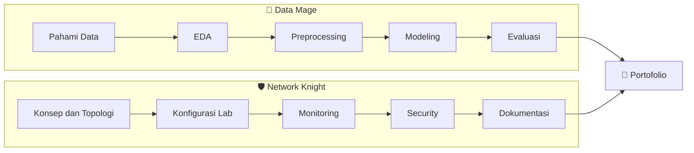

<!-- 🕵️ Level 0 secret: kamu membaca source README ini. Ada 1 easter egg lagi di bagian paling bawah. -->

<div align="center">

<a href="https://github.com/bjorwi69">
  
</a>

<a href="https://github.com/bjorwi69">
  
</a>

<br/>

[](#about)
[](#class)
[](#terminal)
[](#quests)
[](#guestbook)


</div>


<a id="about"></a>

## 🎮 PLAYER CARD

<table>
  <tr>
    <td width="34%" align="center" valign="middle">
      
      <br/><sub><b>Ember</b>, naga penjaga repo ini 🔥</sub>
    </td>
    <td width="66%" valign="top">

```yaml
player:     Ropz
class:      Dual-class (Data Mage x Network Knight)
guild:      Mahasiswa Teknik Informatika
base:       Palembang, Indonesia
Focus:      Data | Nachine Learning | Networking
status:     online, belajar
```

Saya sedang membangun dua jalur sekaligus: **analisis data dan machine learning**, serta **network engineering**. Keduanya saling melengkapi: data yang baik butuh jaringan yang andal, dan jaringan yang baik butuh data untuk dipantau dan dipahami.

</td>
  </tr>
</table>


<a id="class"></a>

## ⚔️ PILIH JALURMU

> Klik salah satu kelas untuk membuka isinya.

<details>
<summary><b>🧙 DATA </b> &nbsp;·&nbsp; Data Analyst · Data Mining · Machine Learning</summary>

<br/>

**Misi:** mengubah data mentah menjadi keputusan yang bisa dipertanggungjawabkan.

| Skill | Status | Catatan |
|---|:-:|---|
| Python | ✅ Dipakai | Bahasa utama untuk proyek data |
| pandas, NumPy | ✅ Dipakai | Data understanding dan preprocessing |
| Matplotlib, Seaborn | ✅ Dipakai | Visualisasi dan EDA |
| scikit-learn | 🔨 Belajar | Klasifikasi dan evaluasi model |
| Decision Tree (ID3, C4.5) | ✅ Dipelajari | Hitung manual pada tabel atribut |
| Web scraping | ✅ Dipelajari | BeautifulSoup dan Selenium (tugas kuliah) |
| Google Colab, Jupyter | ✅ Dipakai | Semua notebook proyek |
| Data Quality Assessment | 🔨 Belajar | Mendeteksi data sintetis, bias, dan kebocoran data |
| SQL, dashboard | 🗺️ Rencana | Setelah proyek ML pertama selesai |

**Quest aktif:** [Brain Tumor Prediction](https://github.com/bjorwi69/Machine-Learning-Project/tree/main/brain-tumor-prediction)

</details>

<details>
<summary><b>🛡️ NETWORK </b> &nbsp;·&nbsp; Network Engineering </summary>

<br/>

**Misi:** 

| Skill | Status | Catatan |
|---|:-:|---|
| Analisis port dan layanan | ✅ Dipelajari | Mengenali layanan berisiko di sistem rentan |
| Serangan brute force SSH | ✅ Dipelajari | Memahami pola serangan dan pencegahannya |
| Wireshark | ✅ Dipelajari | Analisis capture dan kebocoran kredensial |
| Firewall Linux | ✅ Dipelajari | Konfigurasi dan perbaikan aturan firewall |
| MikroTik | 🔨 Belajar | Persiapan home lab |
| Routing dan switching | 🔨 Belajar | Fondasi konsep jaringan |
| AWS VPC | 🗺️ Rencana | Lab hybrid: MikroTik ke AWS VPC |
| Dokumentasi jaringan | 🔨 Belajar | Topologi dan catatan konfigurasi di GitHub |

**Quest berikutnya:** 

</details>

<details>
<summary><b>🐉 DUAL-CLASS </b> &nbsp;·&nbsp; kenapa dua jalur?</summary>

<br/>



Titik temunya: **monitoring dan analisis lalu lintas jaringan** adalah masalah data, dan **pipeline data** hidup di atas jaringan. Itu arah yang ingin saya tuju.

</details>


<a id="terminal"></a>

## 💻 TERMINAL

> Klik perintah di bawah untuk "menjalankannya".

<details>
<summary><code>$ whoami</code></summary>

```text
ropz
mahasiswa Teknik Informatika | calon Data Analyst | calon Network Engineer
```

</details>

<details>
<summary><code>$ ping ropz</code></summary>

```text
PING ropz (github.com/bjorwi69): 56 data bytes
64 bytes from ropz: icmp_seq=1 ttl=64 time=0.1 ms   status=online
64 bytes from ropz: icmp_seq=2 ttl=64 time=0.1 ms   status=learning
64 bytes from ropz: icmp_seq=3 ttl=64 time=0.1 ms   status=committing

--- ropz ping statistics ---
3 packets transmitted, 3 received, 0% packet loss
```

</details>

<details>
<summary><code>$ traceroute goals</code></summary>

```text
traceroute to goals (data-analyst, network-engineer), 4 hops max
 1  brain-tumor-prediction     [selesai: modeling dan evaluasi]
 2  proyek-ml-mingguan         [1 proyek / minggu]
 3  lab-jaringan-pertama       [MikroTik + dokumentasi topologi]
 4  portofolio-yang-bisa-diverifikasi   <-- tujuan
```

</details>

<details>
<summary><code>$ cat toolbox.txt</code></summary>

```text
[DATA]     python  pandas  numpy  matplotlib  seaborn  scikit-learn  jupyter  colab
[NETWORK]  wireshark  linux  ssh  firewall  mikrotik(learning)  aws-vpc(planned)
[WORKFLOW] git  github  vscode
```

</details>

<details>
<summary><code>$ sudo hire ropz</code></summary>

```text
[sudo] password for you: ********
ACCESS GRANTED

Terima kasih sudah mampir. Cara tercepat menghubungi saya:
  - Tinggalkan pesan di Guestbook (bagian bawah halaman ini)
  - Atau ajak saya kolaborasi lewat issue di repo ini
```

</details>


<a id="quests"></a>

## 📜 QUEST LOG

<table>
  <tr>
    <td width="50%" valign="top">

### 🧠 Brain Tumor Prediction
`QUEST AKTIF` &nbsp; 🧙 Data Mage

Klasifikasi biner untuk memprediksi keberadaan tumor otak dari data klinis.

**Plot twist:** setelah preprocessing, sebaran atribut dataset terlihat sangat linear dan teratur, indikasi **data sintetis**. Proyek ini jadi latihan *data quality assessment*, bukan sekadar mengejar akurasi.

`Python` `pandas` `scikit-learn` `Colab`

[](https://github.com/bjorwi69/Machine-Learning-Project/tree/main/brain-tumor-prediction)

</td>
    <td width="50%" valign="top">

### 🛰️ Network Lab #1
`SEGERA` &nbsp; 🛡️ Network

Dokumentasi lab jaringan pertama: topologi, konfigurasi, dan pengujian konektivitas.

**Target:** setiap lab punya diagram, langkah konfigurasi yang bisa diulang, dan catatan pelajaran, ditulis supaya orang lain bisa mengikutinya.

`MikroTik` `Linux` `Wireshark`


</td>
  </tr>
</table>

### ✅ Checklist Quest

**🧙 Jalur Data**
- [x] Membangun struktur repo proyek ML mingguan
- [x] Proyek 1: data understanding dan preprocessing
- [ ] Proyek 1: modeling dan evaluasi
- [ ] Proyek regresi
- [ ] Proyek clustering
- [ ] Proyek NLP: deteksi komentar pelecehan
- [ ] Dashboard analisis data pertama

**🛡️ Jalur Jaringan**
- [x] Praktik analisis keamanan: port, SSH, Wireshark, firewall (tugas kuliah)
- [ ] Menyiapkan home lab MikroTik
- [ ] Dokumentasi lab jaringan pertama dengan diagram topologi
- [ ] Lab hybrid: MikroTik ke AWS VPC


## 🧰 ARSENAL

<div align="center">


</div>


## 📊 STATS

<div align="center">


<picture>
  <source media="(prefers-color-scheme: dark)" srcset="https://raw.githubusercontent.com/bjorwi69/bjorwi69/output/github-snake-dark.svg">
  <source media="(prefers-color-scheme: light)" srcset="https://raw.githubusercontent.com/bjorwi69/bjorwi69/output/github-snake.svg">
  
</picture>

</div>


<a id="guestbook"></a>

## 💬 GUESTBOOK & SIDE QUESTS

Profil ini interaktif. Klik tombol, lalu tekan **Submit new issue** untuk mengirim pesan langsung ke saya.

<div align="center">

[](https://github.com/bjorwi69/bjorwi69/issues/new?title=%F0%9F%93%96+Guestbook%3A+Halo+Ropz%21&body=Nama+%2F+asal%3A+%0A%0APesan%3A+%0A%0A%28Terima+kasih+sudah+mampir%21%29)
[](https://github.com/bjorwi69/bjorwi69/issues/new?title=%F0%9F%8E%AF+Side+quest%3A+&body=Usulan+dataset+atau+lab+jaringan%3A+%0A%0AKenapa+menarik%3A+)
[](https://github.com/bjorwi69/bjorwi69/issues/new?title=%F0%9F%A4%9D+Kolaborasi%3A+&body=Ide+atau+proyek%3A+%0A%0ARencana%3A+)

</div>

<details>
<summary>↑ ↑ ↓ ↓ ← → ← → B A</summary>

<br/>

```text
 CHEAT CODE ACCEPTED

              ____
      /\_/\_/\  \  \_    "Model dengan akurasi 99%
     /  o  o   \__/ )     pada data yang salah
    (  =^w^=  _____/      tetap model yang salah."
     \_/\/\_/  ~~~~~ )~
```

Kamu menemukan easter egg terakhir. Pelajaran terpenting sejauh ini: **kualitas data dan kejelasan dokumentasi menentukan segalanya**, baik di analisis data maupun di jaringan.

Kalau kamu sampai sini, kamu teliti, dan itu sifat yang saya cari dari seorang analis maupun engineer. 🐉

</details>

<br/>


<div align="center"><sub>Dibuat dengan ☕, data, paket jaringan, dan seekor naga bernama Ember.</sub></div>
