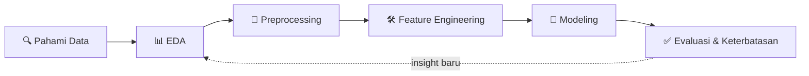

<!-- 🕵️ Psst... kamu menemukan komentar tersembunyi. Scroll ke bawah, ada satu rahasia lagi. -->

<div align="center">


<a href="https://github.com/bjorwi69">
  
</a>

<br/>


</div>

---

## 👋 Tentang Saya

```python
class Ropz:
    def __init__(self):
        self.role      = "Informatics Engineering Student"
        self.location  = "Palembang, Indonesia 🇮🇩"
        self.learning  = ["Networking", "Machine Learning", "Data Mining", "Data Storytelling"]
        self.motto     = "Check the data quality before celebrating the accuracy."
```

Saya mahasiswa Teknik Informatika yang sedang membangun portofolio **Networking** dan **Data Analyst** dengan harapan secara konsisten membuat project dan menampilkan portofolio yang menarikr.

---

## 🧭 Yang Sedang Saya Kerjakan

| | |
|:--|:--|
| 🔭 **Proyek aktif** | [Machine-Learning-Project](https://github.com/bjorwi69/Machine-Learning-Project): kumpulan proyek Machine Learning |
| 🌱 **Sedang dipelajari** | Klasifikasi, EDA yang rapi, evaluasi model, dan mendeteksi masalah kualitas data |
| 🎯 **Target** | Menjadi Data Analyst dengan portofolio yang bisa diverifikasi |
| 💬 **Tanya saya tentang** | Python, pandas, scikit-learn, Google Colab, workflow Git/GitHub |

---

## 🚀 Proyek Pilihan

<table>
  <tr>
    <td width="50%" valign="top">

### 🧠 Brain Tumor Prediction
Klasifikasi biner untuk memprediksi keberadaan tumor otak dari data klinis.

**Temuan menarik:** 

`Python` `pandas` `scikit-learn` `Colab`

[](https://github.com/bjorwi69/Machine-Learning-Project/tree/main/brain-tumor-prediction)

</td>
    <td width="50%" valign="top">

### 🗺️ Proyek Berikutnya


**Pola kerja:** setiap proyek mengikuti alur yang sama dari pemahaman data sampai evaluasi, dengan README, log harian, dan notebook yang bisa dibuka langsung di Colab.

`Regresi` `Clustering` `NLP`

[](https://github.com/bjorwi69/Machine-Learning-Project)

</td>
  </tr>
</table>

---

## 🔄 Cara Saya Mengerjakan Proyek



---

## 🛠️ Tools yang Saya Pakai

<div align="center">


</div>

---

## 📈 Statistik GitHub

<div align="center">


</div>

---

## 🐍 Grafik Kontribusi

<div align="center">

<picture>
  <source media="(prefers-color-scheme: dark)" srcset="https://raw.githubusercontent.com/bjorwi69/bjorwi69/output/github-snake-dark.svg">
  <source media="(prefers-color-scheme: light)" srcset="https://raw.githubusercontent.com/bjorwi69/bjorwi69/output/github-snake.svg">
  
</picture>

</div>

---

## 🗓️ Roadmap 2026

- [x] Membangun struktur repo proyek Machine Learning
- [x] Proyek 1: Brain Tumor Prediction (data understanding dan preprocessing)
- [ ] Menyelesaikan modeling dan evaluasi proyek 1
- [ ] Proyek: Regresi
- [ ] Proyek: Clustering
- [ ] Proyek: Deteksi komentar pelecehan (NLP)
- [ ] Dashboard analisis data pertama

---

<details>
<summary>🔐 <b>Klik untuk membuka rahasia</b></summary>

<br/>

> *"Model dengan akurasi 99% pada data yang salah tetap model yang salah."*

Hal yang paling saya pelajari sejauh ini: **kualitas data menentukan segalanya.** Karena itu setiap proyek saya diawali dengan pertanyaan: *apakah datanya layak dipercaya?*

Fakta kecil: README ini punya satu komentar tersembunyi di baris paling atas. Kalau kamu menemukannya, kamu orang yang teliti, dan itulah sifat yang saya cari dari seorang analis data. 😉

</details>

---

<div align="center">

### 🤝 Mari Terhubung

[](https://github.com/bjorwi69)

<sub>Dibuat dengan ☕, data, dan rasa penasaran.</sub>


</div>
